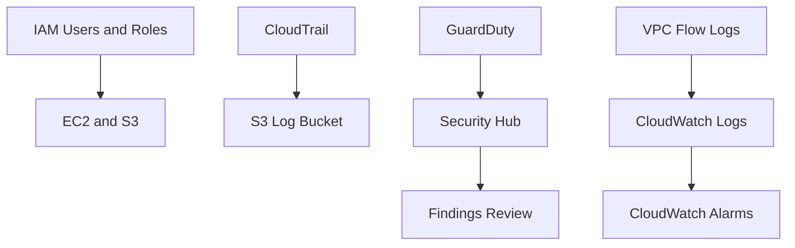

# AWS Cloud Security

Status - Lab template to be completed. This repo is a hands-on lab plan for learning AWS security. It is not production experience and it is not a completed project. Work through the labs in a free tier or personal AWS account, watch the spend, take your own screenshots, and update the status line of each lab as you finish it.

## Objective

Learn how AWS security works by building it yourself. IAM users, roles, and policies with least privilege. GuardDuty for threat detection. Security Hub for a central view of findings. CloudTrail for audit logging. CloudWatch for alarms. VPC flow logs for network evidence. The goal is to understand the shared responsibility model in practice, not just as a diagram.

## Architecture



## Technologies used

- AWS IAM
- Amazon GuardDuty
- AWS Security Hub
- AWS CloudTrail
- Amazon CloudWatch
- VPC Flow Logs
- Amazon S3
- AWS CLI

## Lab topology

- One AWS account for the lab, region us-east-1
- One VPC on 10.0.0.0/16 with a public and a private subnet
- One S3 bucket for CloudTrail logs, with versioning on and public access blocked
- One IAM user for lab work, with MFA on
- One IAM role for EC2 with read only access to S3
- GuardDuty and Security Hub turned on in the same region

## Configuration examples

Create an IAM user for lab work.

```
aws iam create-user --user-name lab-user
```

Attach a managed policy that allows read only EC2 access.

```
aws iam attach-user-policy --user-name lab-user --policy-arn arn:aws:iam::aws:policy/AmazonEC2ReadOnlyAccess
```

Create an access key for the user.

```
aws iam create-access-key --user-name lab-user
```

Create a custom policy that allows listing one S3 bucket and nothing else. Save it as s3-read-only.json.

```json
{
  "Version": "2012-10-17",
  "Statement": [
    {
      "Effect": "Allow",
      "Action": [
        "s3:ListBucket",
        "s3:GetObject"
      ],
      "Resource": [
        "arn:aws:s3:::lab-bucket-0123456789",
        "arn:aws:s3:::lab-bucket-0123456789/*"
      ]
    }
  ]
}
```

Create the policy and attach it to the user.

```
aws iam create-policy --policy-name LabS3ReadOnly --policy-document file://s3-read-only.json
aws iam attach-user-policy --user-name lab-user --policy-arn arn:aws:iam::123456789012:policy/LabS3ReadOnly
```

Create an IAM role for EC2 with the same read only access.

```
aws iam create-role --role-name lab-ec2-role --assume-role-policy-document file://trust-policy.json
aws iam attach-role-policy --role-name lab-ec2-role --policy-arn arn:aws:iam::aws:policy/AmazonS3ReadOnlyAccess
```

Turn on GuardDuty.

```
aws guardduty create-detector --enable
```

Turn on Security Hub.

```
aws securityhub enable-security-hub
```

Create the S3 bucket for CloudTrail logs.

```
aws s3api create-bucket --bucket lab-trail-bucket-0123456789 --region us-east-1
aws s3api put-public-access-block --bucket lab-trail-bucket-0123456789 --public-access-block-configuration BlockPublicAcls=true,IgnorePublicAcls=true,BlockPublicPolicy=true,RestrictPublicBuckets=true
```

Create the CloudTrail trail and start logging.

```
aws cloudtrail create-trail --name lab-trail --s3-bucket-name lab-trail-bucket-0123456789 --is-multi-region-trail
aws cloudtrail start-logging --name lab-trail
```

Turn on VPC flow logs to CloudWatch.

```
aws ec2 create-flow-logs --resource-type VPC --resource-ids vpc-0123456789abcdef0 --traffic-type ALL --log-destination-type cloud-watch-logs --log-group-name lab-flow-logs
```

Create a CloudWatch alarm for failed console logins.

```
aws cloudwatch put-metric-alarm --alarm-name lab-failed-logins --metric-name ConsoleSignInFailureCount --namespace AWS/CloudTrail --statistic Sum --period 300 --threshold 3 --comparison-operator GreaterThanOrEqualToThreshold --evaluation-periods 1 --alarm-actions arn:aws:sns:us-east-1:123456789012:lab-alerts
```

## Implementation steps

1. Create the lab IAM user, turn on MFA, and create an access key
2. Attach the read only policy and test that the user can list EC2 instances but cannot start one
3. Create the custom S3 policy, attach it, and test that the user can read the lab bucket but not other buckets
4. Create the EC2 role and launch an instance with it attached
5. Turn on GuardDuty and Security Hub
6. Create the S3 bucket and the CloudTrail trail, then run a few commands and find them in the trail logs
7. Turn on flow logs and read one entry in CloudWatch
8. Create the failed login alarm and test it with a wrong password

## Verification commands

```
aws iam get-user --user-name lab-user
aws iam list-attached-user-policies --user-name lab-user
aws iam simulate-principal-policy --policy-source-arn arn:aws:iam::123456789012:user/lab-user --action-names ec2:StartInstances
aws guardduty list-detectors
aws guardduty list-findings --detector-id 0123456789abcdef0123456789abcdef
aws securityhub get-findings --max-results 5
aws cloudtrail get-trail-status --name lab-trail
aws cloudtrail lookup-events --lookup-attributes AttributeKey=Username,AttributeValue=lab-user --max-results 5
aws logs filter-log-events --log-group-name lab-flow-logs --limit 5
aws cloudwatch describe-alarms --alarm-names lab-failed-logins
```

## Troubleshooting scenarios

- The IAM user can do something they should not, so check the attached policies and look for a broad managed policy that grants more than intended
- The simulate policy check says denied but the real call works, so check for a permission boundary or a second policy attached to the group
- GuardDuty shows no findings, so remember that GuardDuty only raises findings when it sees real suspicious activity, and a quiet lab is normal
- CloudTrail shows no events, so check the trail status is logging and the S3 bucket policy allows CloudTrail to write
- Flow logs are empty, so check the log group exists, the IAM role for flow logs is correct, and traffic actually moved
- The alarm never fires, so check the metric name and namespace match the CloudTrail metric filter you created

## Shared responsibility model

- AWS looks after the security of the cloud itself, which means the physical data centres, the hardware, and the software that runs the services
- You look after security in the cloud, which means your data, your IAM users and roles, your security groups, your encryption settings, and your logs
- A misconfigured security group is your fault, not AWS, and a failed disk in a data centre is AWS, not yours

## Security best practices

- Give every user and role the least privilege they need and nothing more
- Turn on MFA for every IAM user, especially the root user
- Never put access keys in code or in a screenshot
- Block public access on every S3 bucket unless you have a written reason not to
- Turn on CloudTrail in every region you use
- Read GuardDuty and Security Hub findings every week
- Rotate access keys on a schedule and delete keys you no longer use

## Learning outcomes

- Build IAM users, roles, and policies with least privilege
- Test a policy with the policy simulator before you trust it
- Turn on GuardDuty and Security Hub and read their findings
- Set up CloudTrail and find your own actions in the audit log
- Use VPC flow logs and CloudWatch alarms as network evidence
- Explain the shared responsibility model with real examples

## Screenshot placeholders

- screenshots/iam-user.png - Placeholder, add a screenshot of the IAM user with MFA turned on
- screenshots/guardduty-findings.png - Placeholder, add a screenshot of the GuardDuty findings page
- screenshots/security-hub.png - Placeholder, add a screenshot of the Security Hub summary

## Project status

Lab template to be completed. No lab in this repo is finished yet. Update this section as each lab is done.
